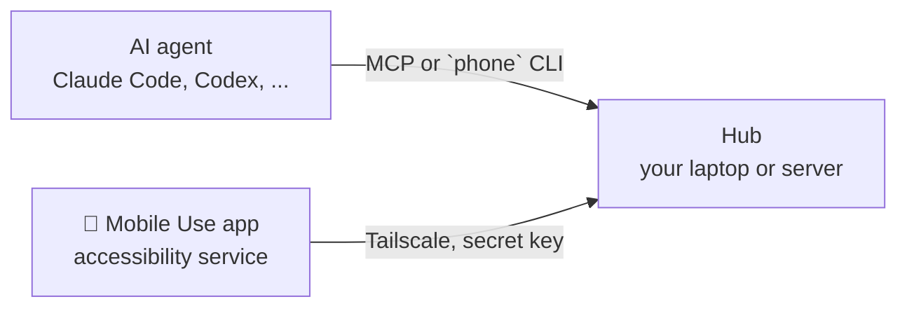

<div align="center">

# 📱 Mobile Use

### Give your AI agent hands on your Android phone.

**Claude Code · Codex · Gemini CLI · Cursor · any agent that can run a command**

[](https://github.com/anonymous-namo-1/mobile-use/actions/workflows/ci.yml)


</div>

---

> **Set it up in one message.** Paste this to your AI agent:
>
> ```
> Set up Mobile Use for me: https://github.com/anonymous-namo-1/mobile-use
> ```
>
> It reads [AGENTS.md](AGENTS.md), asks whether to run on your **laptop** (free, but it has to
> stay on) or a **cloud server** (24/7, a few dollars a month), and walks you through the rest.

---

## What it does

Your agent can **see** your phone screen as a numbered list of buttons and fields (plus a
screenshot), and **act**: tap, type, scroll, open apps, wait for things to appear. Think
"computer use", but for the phone in your pocket, from anywhere.

```
You: "Report my Amazon package as not delivered."
Agent: look → open_app("Amazon") → tap [12] "Your Orders" → tap [4] "Power bank" →
       tap [7] "Says delivered, but it's not here" → tap [9] "Raise a Query" ✓
```

## Why it's different

| | Screenshot-only agents | ADB-based tools | **Mobile Use** |
|---|---|---|---|
| How it sees | Guesses from pixels | Slow UI dumps (~2–3 s) | Android accessibility tree, **~0.3 s** |
| How it taps | Coordinates | Coordinates | **By element number**, exact |
| Typing | Often ASCII only | ASCII only | **Any language + emoji** (नमस्ते 👍) |
| Works on mobile data / after reboot | Depends | ❌ Wi-Fi debugging only | ✅ app connects out over Tailscale |
| You can see & stop it | ❌ | ❌ | ✅ **blue glow + Stop button** |
| Approves risky actions | ❌ | ❌ | ✅ **Allow / Deny on the phone** |

*Speeds measured on a recent Samsung phone over Tailscale, hub on a small cloud server.*

## How it works



- The **app** on the phone reads the screen and performs gestures through Android's
  accessibility service, and keeps a private connection **out** to your hub.
- The **hub** runs on your laptop or a small server, listens only on your Tailscale address and
  only accepts a phone that knows its secret key.
- Your **agent** uses the MCP tools (`look`, `tap`, `type_text`, …) or the `phone` command.

## You stay in control

- 🔵 A **glowing blue border** and an "AI agent is using your phone" notification whenever an agent acts.
- ⏹️ **Stop** in that notification blocks every agent for 30 minutes (**Resume** to undo).
- ✅ Payment/banking apps and **Send / Pay / Buy / Delete** buttons need your **Allow** on the phone.
- 🔒 Password and PIN fields are refused by the app itself.
- 🧑‍🤝‍🧑 Two agents never fight over the phone: a shared lock lets one drive at a time.

## Tools

| MCP tool | `phone` command | What it does |
|---|---|---|
| `look` | `phone look` | Numbered list of buttons/fields/text (+ screenshot with boxes) |
| `tap(ref)` | `phone click N` | Tap an element by number (or `tap(x, y)`) |
| `type_text(text, ref, enter)` | `phone type N "text" enter` | Type into a field, any language |
| `scroll`, `swipe`, `press_key` | `phone scroll down`, `phone key back` | Navigate |
| `open_app(name)` | `phone open "WhatsApp"` | Open apps by name |
| `find(text)`, `wait_for(text)` | `phone find "…"`, `phone wait "…"` | Scroll until visible / wait until it appears |
| `ask_owner(question)` | `phone ask "…"` | Allow / Deny notification on the phone |

## You need

- An **Android 11+** phone (iPhone can't do this: iOS doesn't allow it)
- A **laptop** or a small **cloud server** for the hub ([which one?](docs/HOSTING_OPTIONS.md))
- A free **Tailscale** account
- An **AI agent**

## Docs

| | |
|---|---|
| 🤖 [AGENTS.md](AGENTS.md) | The step-by-step script your AI agent follows |
| 🖥️ [Hosting options](docs/HOSTING_OPTIONS.md) | Laptop vs cloud server vs Raspberry Pi |
| 🛠️ [Setup](docs/SETUP.md) | All steps, if you'd rather do it yourself |
| 📱 [Phone notes](docs/PHONE_SETUP.md) | Samsung/Xiaomi battery savers, "restricted settings" |
| 🔌 [Connect your agent](docs/CONNECT_YOUR_AGENT.md) | Claude Code, Codex, Gemini CLI, Cursor, CLI |
| 🔐 [Security](docs/SECURITY.md) | Who can reach your phone (only you) |
| 🩺 [Troubleshooting](docs/TROUBLESHOOTING.md) | Common problems and fixes |
| 🗺️ [Roadmap](docs/ROADMAP.md) | QR-code setup, one-command installer, … |

## FAQ

**Do I need a server?** No. Your laptop works; the catch is it has to be on and awake for your
agent to reach the phone. A small cloud server (or Raspberry Pi) makes it 24/7.

**Can people who clone this reach my phone?** No. Every install has its own hub, secret key and
app connection, inside your own Tailscale network. See [SECURITY.md](docs/SECURITY.md).

**Why not the Play Store?** Google is (rightly) strict with accessibility apps. Install the APK
from [`dist/`](dist/) (check its SHA-256) or build it yourself from [`app/`](app/).

## Project layout

```
app/        Android app (Java, no Gradle: javac + d8 + aapt2), build.sh
server/     hub.py · mcp_server.py · phonectl (the `phone` command) · service files
dist/       ready-made APK + checksum
docs/       setup guides for humans and AI agents
tests/      end-to-end test with a fake phone (runs in CI)
```

## License

[MIT](LICENSE). Built with Claude Code.
